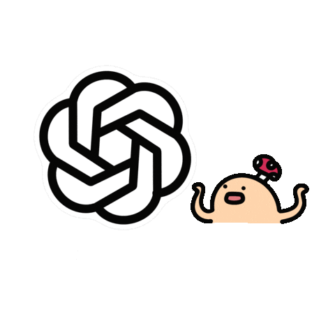

    

---

### Hey, I'm Tomasz 

I build software at **Bayer**, mostly full-stack: Python on the backend, React + TypeScript on the front, Terraform and AWS underneath. Backend is home, though.

Currently tinkering with:

- 🤖 a RAG pipeline that reads source code and writes the docs, so nobody has to
- 📱 **[Count Days Simple](https://apps.apple.com/pl/app/count-days-simple/id6479526942)**, my little Swift app that's still alive and getting updates
- 🚦 RL for traffic signal control, the topic of my master's at Warsaw University of Technology.

 

  
  
  
  
  

##  Stack

  
  
  
  
  
  
  

also speak:

  
  
  
  

---

🏆 Won the 10th BEST Hacking League hackathon by syncing Earth and Mars calendars.

